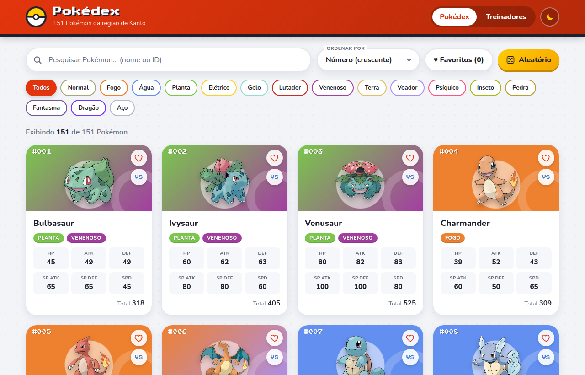
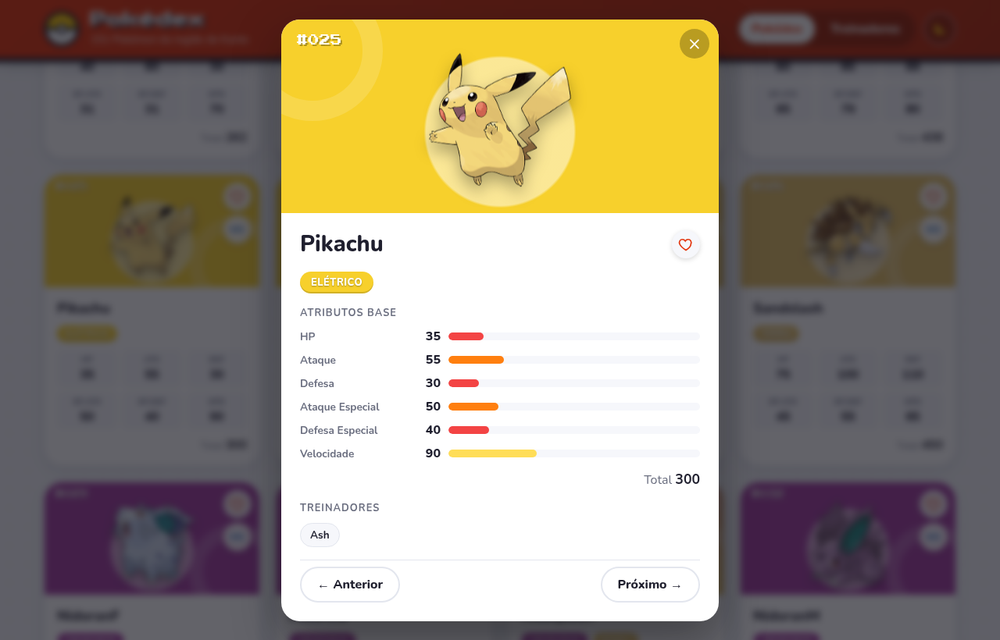
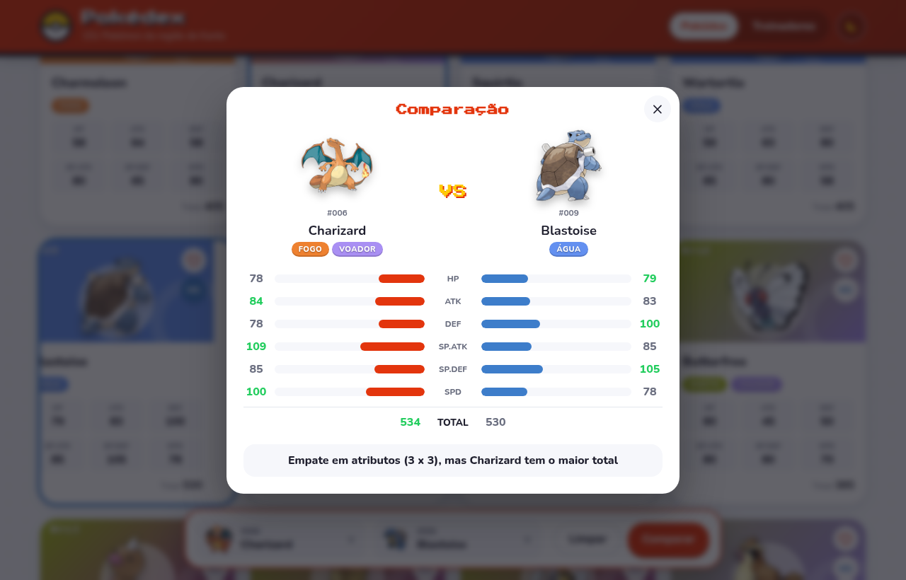
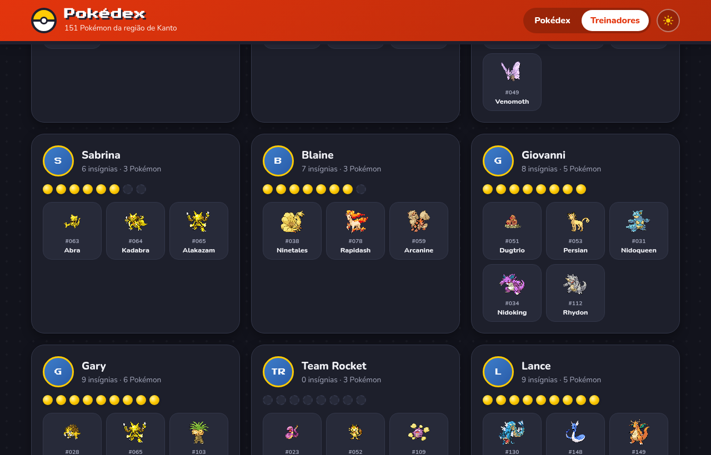
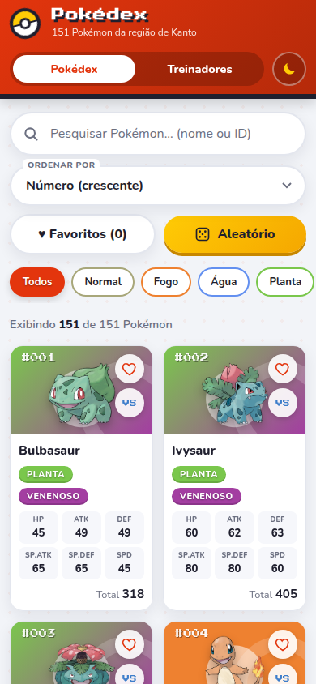

# 🎮 Pokédex — React + Vite

Pokédex interativa para explorar os **151 Pokémon da região de Kanto**: pesquise por nome ou número, filtre por tipo, veja os detalhes e atributos de cada Pokémon, consulte os treinadores e compare dois Pokémon lado a lado.

Atividade 03 da disciplina **Desenvolvimento e Integração de Aplicações Web**.



## 👥 Integrantes

- Plínio Ferreira
- Ana Clara Freitas da Silva

## ✨ Funcionalidades

### Requisitos da atividade

- 🐾 **Listagem** de todos os Pokémon do arquivo `pokedex-data.json`, em cards com número, nome, tipos e os 6 atributos (HP, Ataque, Defesa, Ataque Especial, Defesa Especial e Velocidade).
- 🔎 **Pesquisa** em tempo real por **nome** (`bulba`) ou **número** (`25`, `025` ou `#025`). Não diferencia maiúsculas, minúsculas ou acentos.
- 🧬 **Filtro por tipo**, usando apenas os tipos que aparecem no arquivo de dados, cada um com a sua cor.
- 📄 **Detalhes do Pokémon** em um modal com barras de atributos animadas, total de atributos e treinadores que possuem o Pokémon. Dá para navegar entre os Pokémon com os botões ou com as setas ← → do teclado, e fechar com `ESC`.
- 🧑‍🚀 **Treinadores**: nome, insígnias e time de cada treinador, com pesquisa e ordenação por insígnias. Clicar em um Pokémon do time abre os detalhes dele.
- ⚠️ **Nenhum resultado**: mensagem própria e botão para limpar os filtros.
- 📱 **Layout responsivo** para desktop, tablet e smartphone.

### Desafios opcionais implementados

- ⭐ **Favoritos**: marque Pokémon com o coração; ficam salvos no `localStorage`.
- 📊 **Ordenação** por número, nome, total ou qualquer atributo.
- ⚔️ **Comparação** entre dois Pokémon, com barras lado a lado e indicação do vencedor.
- 🎲 **Pokémon aleatório**: sorteia um Pokémon da lista atual.
- 🌙 **Tema escuro**, que segue a preferência do sistema e guarda a escolha.

| Detalhes | Comparação |
| --- | --- |
|  |  |

| Treinadores (tema escuro) | Celular |
| --- | --- |
|  |  |

## ▶️ Como executar

Pré-requisito: [Node.js](https://nodejs.org/) 20.19 ou superior (com npm).

```bash
# 1. Clonar o repositório
git clone https://github.com/afplinio/atividade-3-pokedex-diaw.git
cd atividade-3-pokedex-diaw

# 2. Instalar as dependências
npm install

# 3. Rodar em modo de desenvolvimento
npm run dev
```

Depois, abra no navegador o endereço exibido no terminal, normalmente **http://localhost:5173/**.

Outros comandos:

| Comando | Descrição |
| --- | --- |
| `npm run dev` | Servidor de desenvolvimento com recarregamento automático |
| `npm run build` | Gera a versão de produção na pasta `dist/` |
| `npm run preview` | Serve localmente a versão gerada pelo `build` |

## 📁 Dados utilizados

Todos os dados vêm do arquivo **`src/data/pokedex-data.json`**, fornecido na atividade e importado diretamente no `App.jsx`:

- `pokemon`: 151 Pokémon com `id`, `name`, `stats` e `types`;
- `types`: lista de tipos (o filtro mostra apenas os usados por algum Pokémon);
- `trainers`: 12 treinadores com `name`, `badges` e `pokemonIds`.

> O Mew (#151) não tem tipo no arquivo, então ele aparece como **"Sem tipo"**.

### 🌐 Imagens (fonte externa)

As imagens vêm do repositório de sprites da **[PokéAPI](https://pokeapi.co/)** ([PokeAPI/sprites](https://github.com/PokeAPI/sprites)). A URL é montada a partir do número do Pokémon, sem chamar a API:

- Arte oficial: `https://raw.githubusercontent.com/PokeAPI/sprites/master/sprites/pokemon/other/official-artwork/{id}.png`
- Sprite (reserva e treinadores): `https://raw.githubusercontent.com/PokeAPI/sprites/master/sprites/pokemon/{id}.png`

Se uma imagem não carregar, o componente `PokemonImage` tenta o sprite reserva e, por fim, mostra um placeholder. **A Pokédex continua funcionando só com o JSON**, mesmo sem internet para as imagens.

## 🧩 Organização do projeto

```text
atividade-3-pokedex-diaw/
├── docs/screenshots/        # Imagens usadas neste README
├── public/
│   └── pokeball.svg         # Ícone da aba do navegador
├── src/
│   ├── components/          # Componentes React (um por arquivo)
│   │   ├── Header.jsx           # Cabeçalho, abas e botão de tema
│   │   ├── SearchBar.jsx        # Campo de pesquisa reutilizável
│   │   ├── TypeFilter.jsx       # Botões de filtro por tipo
│   │   ├── SortSelect.jsx       # Seleção de ordenação
│   │   ├── RandomButton.jsx     # Botão de Pokémon aleatório
│   │   ├── PokemonList.jsx      # Grade de cards (map)
│   │   ├── PokemonCard.jsx      # Card com tipos e atributos
│   │   ├── PokemonImage.jsx     # Imagem com lazy loading e reserva
│   │   ├── TypeBadge.jsx        # Etiqueta colorida do tipo
│   │   ├── FavoriteButton.jsx   # Botão de favoritar
│   │   ├── Modal.jsx            # Modal genérico (ESC, clique fora)
│   │   ├── PokemonDetails.jsx   # Modal de detalhes
│   │   ├── StatBar.jsx          # Barra de atributo
│   │   ├── CompareTray.jsx      # Barra inferior da comparação
│   │   ├── ComparePanel.jsx     # Modal da comparação
│   │   ├── TrainerList.jsx      # Seção de treinadores
│   │   ├── TrainerCard.jsx      # Card de treinador
│   │   ├── ThemeToggle.jsx      # Alternância claro/escuro
│   │   ├── EmptyState.jsx       # Mensagem de "nenhum resultado"
│   │   └── Footer.jsx
│   ├── css/                 # Um arquivo de estilo por componente + App.css
│   ├── data/
│   │   └── pokedex-data.json    # Fonte de dados da aplicação
│   ├── hooks/
│   │   ├── useFavorites.js      # Favoritos + localStorage
│   │   └── useTheme.js          # Tema claro/escuro
│   ├── utils/
│   │   ├── pokemon.js           # Cores, rótulos, pesquisa, filtros, imagens
│   │   └── sort.js              # Opções e função de ordenação
│   ├── App.jsx              # Estado principal e composição da tela
│   ├── main.jsx             # Ponto de entrada do React
│   └── index.css            # Variáveis de tema e estilos globais
├── index.html
├── package.json
└── vite.config.js
```

### Árvore de componentes

```text
App
 ├── Header
 │    └── ThemeToggle
 ├── (aba Pokédex)
 │    ├── SearchBar
 │    ├── SortSelect · Favoritos · RandomButton
 │    ├── TypeFilter
 │    ├── PokemonList
 │    │    └── PokemonCard ×N
 │    │         ├── PokemonImage · TypeBadge
 │    │         └── FavoriteButton · botão VS
 │    └── EmptyState
 ├── (aba Treinadores)
 │    └── TrainerList
 │         ├── SearchBar
 │         └── TrainerCard ×N
 ├── Footer
 ├── CompareTray
 ├── PokemonDetails  →  Modal + StatBar
 └── ComparePanel    →  Modal
```

## ⚛️ Conceitos de React aplicados

| Conceito | Onde |
| --- | --- |
| Componentes funcionais e props | Todos os arquivos de `src/components` |
| `useState` | Pesquisa, tipo, ordenação, aba, Pokémon selecionado, comparação |
| `useEffect` | Fechar modal com `ESC`, travar rolagem, setas do teclado, salvar favoritos e tema |
| `useMemo` | Lista filtrada e ordenada (estado derivado) |
| `useCallback`, `useRef`, `useId` | Navegação do modal, foco ao abrir, ids acessíveis |
| Hooks customizados | `useFavorites` e `useTheme` |
| Renderização de listas com `map()` | Cards, tipos, atributos, treinadores e times |
| Eventos | `onClick`, `onChange`, `onKeyDown`, `onError`, `onLoad` |
| Renderização condicional | Abas, estado vazio, modais e barra de comparação |
| Reutilização de componentes | `SearchBar`, `Modal`, `TypeBadge`, `PokemonImage`, `FavoriteButton`, `EmptyState` |

## 🛠️ Tecnologias

- [React 19](https://react.dev/)
- [Vite 8](https://vite.dev/) com `@vitejs/plugin-react`
- CSS puro com variáveis (sem frameworks); fontes *Nunito* e *Press Start 2P* do Google Fonts

Nenhuma biblioteca além de React e Vite foi usada. Todas as dependências estão no `package.json`.

## ⚖️ Créditos

Pokémon e seus nomes são marcas registradas de Nintendo, Game Freak e The Pokémon Company. Projeto acadêmico, sem fins comerciais. Imagens: [PokéAPI](https://pokeapi.co/).
